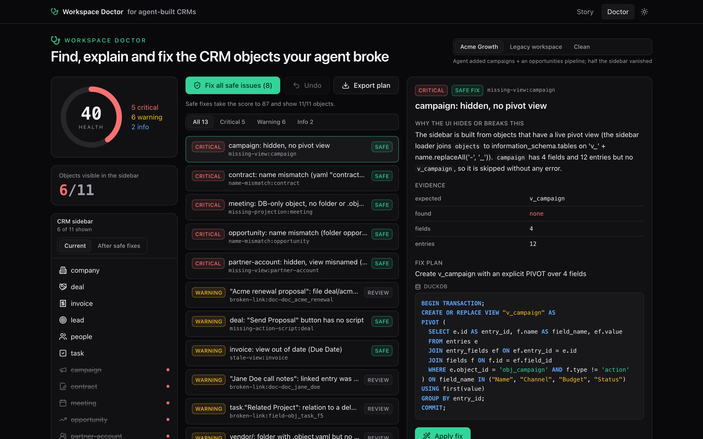
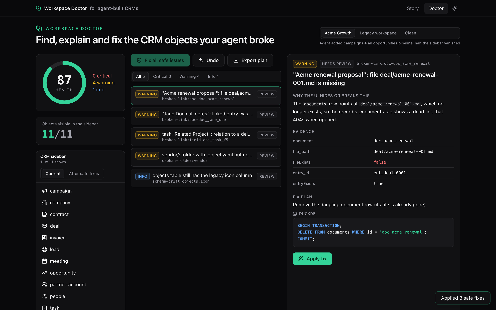
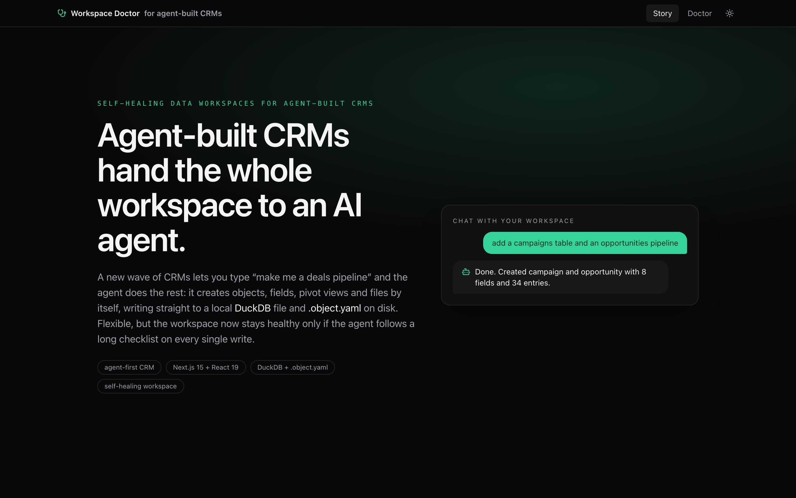
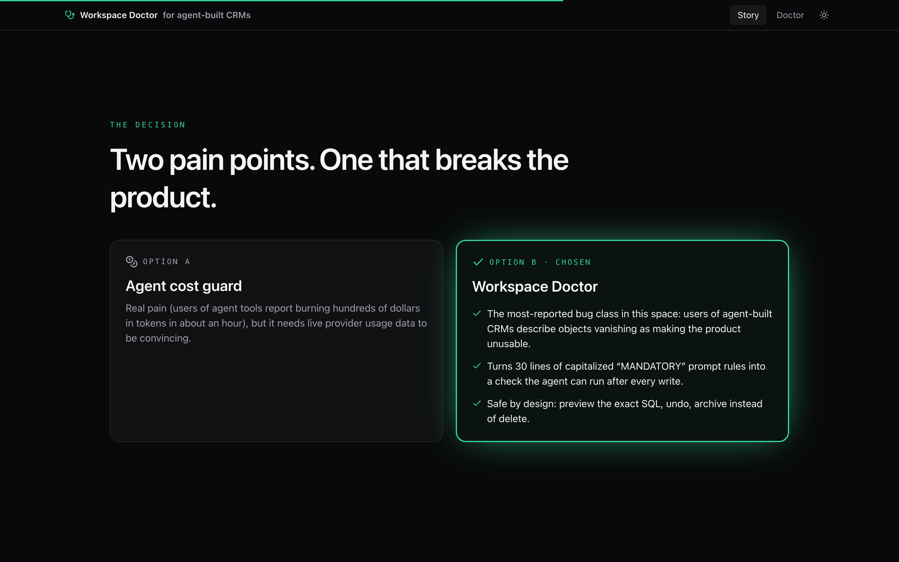

# Workspace Doctor

**Self-healing data workspaces for agent-built CRMs. Find, explain and fix the CRM objects your agent broke.**






## The problem

A new wave of agent-first CRMs lets an LLM agent own the workspace end to end. You say "make me a deals pipeline" and the agent creates objects, adds fields, writes rows, builds views and attaches action buttons, all by running SQL against a local **DuckDB** file (`objects`, `fields`, `entries`, generated `v_<object>` PIVOT views) and projecting every object onto disk as `<object>/.object.yaml`.

An object only shows up in the sidebar when four things agree:

1. the `objects` row in DuckDB
2. a live pivot view named `'v_' + name.replaceAll('-', '_')`
3. a root directory with the same name
4. a `.object.yaml` whose `name:` matches

Tools in this space usually ask the agent to keep these aligned through capitalised "MANDATORY" rules in its prompt. When the agent skips a step, the object silently disappears: the sidebar loader drops any object that has no view, and projection errors only go to `console.warn`. Users of popular tools in this space report that this class of bug "makes the product unusable", and it is the most common integrity bug in the category: hyphenated names that break view lookup, plural/singular folder drift, deleted objects that keep reappearing.

## Why this feature

Two pain points stood out in this domain: runaway agent token spend, and silent workspace corruption. I picked the second because:

- it breaks the product outright (data the user just created vanishes, with no error), while cost is an annoyance;
- it turns prompt rules into a deterministic check the agent can run after every write;
- it can be built and verified offline, with no live provider data.

## The feature: diagnose, explain, fix

The Doctor runs 9 checks over a workspace snapshot. For each finding it explains in plain English why the UI hides or breaks the object, shows the exact DuckDB SQL and file operations as a diff, and applies the fix with undo.

| # | check | severity | detects | fix |
|---|---|---|---|---|
| 1 | `missing-view` | critical | no `v_<name>` view, including the hyphen trap (`v_partner-account`) | `CREATE OR REPLACE VIEW` with an explicit `PIVOT ... IN (...)`, drop the misnamed view (safe) |
| 2 | `stale-view` | warning | view columns differ from `entry_id` + non-action fields | regenerate the view (safe) |
| 3 | `name-mismatch` | critical | DB name, folder name and yaml `name` disagree | rename the folder, rewrite the yaml, re-point documents (safe; refuses on conflict) |
| 4 | `missing-projection` | critical | DB object with no folder or `.object.yaml` | `mkdir` + yaml built from DB fields (safe) |
| 5 | `orphan-folder` | warning | root folder with `.object.yaml` but no DB row | move to `tmp/doctor-archive/<ts>/`, never deleted (review) |
| 6 | `missing-action-script` | warning | action button whose `.actions/<script>` is missing | stub script that reports TODO (safe) |
| 7 | `entry-count-drift` | info | yaml `entry_count` differs from `COUNT(entries)` | update the yaml (safe) |
| 8 | `schema-drift` | info | legacy `objects.icon`, or missing `hidden_in_sidebar`/`sort_order` | copy icons to yaml, then drop the column / `ADD COLUMN IF NOT EXISTS` (review) |
| 9 | `broken-link` | warning | document with a missing file or a deleted entry; relation to a deleted object | re-point, remove the row, unlink, or downgrade the relation to text (review) |

On the `acme` seed the Doctor finds **13 findings (5 critical, 6 warning, 2 info)**, a health score of **40**, and **6 of 11** objects visible. **Fix all safe issues** brings that to **11/11** and a score of **87**. After the 5 review fixes the score is **100**.

Safety by design:
- `applyFix` is pure: it returns a new snapshot and never mutates the old one, so Undo is exact.
- A rename onto an existing folder returns a `conflict` finding instead of overwriting.
- Orphans are archived, never deleted. Every path goes through `resolveInside()`, which rejects `../`.
- Fixes that change user data ("review") need confirmation.
- **Export plan** downloads `doctor-fix.sql` (one transaction per finding) and `doctor-fix.sh` (`set -euo pipefail`, quoted paths, conflict guards).

The `/story` route is an animated explainer covering the domain, the pain point, why it breaks, the decision, the feature, and the impact. Every number on it is computed live from the engine.

## Measured impact (acme seed, computed by the engine)

| metric | before | after "Fix all safe" | after all fixes |
|---|---|---|---|
| health score | 40 | 87 | 100 |
| visible objects | 6/11 | 11/11 | 11/11 |
| findings | 13 (5 critical) | 5 (review) | 0 |

## How it would plug into a host CRM

- **Data source:** `src/lib/source/duckdb-source.ts` is a documented stub for a `DuckDbWorkspaceSource` (via `@duckdb/node-api` + `fs`). The demo uses `SeedWorkspaceSource` only.
- **CLI:** a `doctor` subcommand would map to `scripts/doctor.ts`. It exits with code 1 when critical findings exist, so the agent can run it as a post-write check after every schema change instead of relying on prompt rules.
- **API:** `GET /api/workspace/doctor` would map to `src/app/api/doctor/route.ts`. `GET ?scenario=` returns a report, and `POST {snapshot}` diagnoses a posted snapshot.
- **UI:** the components use a standard Next.js + Tailwind stack, so they can drop into a host app.

## Run

```bash
pnpm i
pnpm dev                              # http://localhost:3000/story and /doctor
pnpm test                             # Vitest: 117 tests
pnpm typecheck && pnpm lint && pnpm build
pnpm run doctor --scenario acme       # table; add --json for JSON; exit 1 on critical
```

Note: plain `pnpm doctor` runs pnpm's own built-in `doctor` command, so use `pnpm run doctor`.

There are no API keys and no network calls. `.env.example` documents `WORKSPACE_DIR`, which the demo does not use.

## Stack

Next.js 15 App Router, React 19, TypeScript (strict), Tailwind CSS 4 (`@tailwindcss/postcss`), framer-motion 12, lucide-react, class-variance-authority, clsx, tailwind-merge, next-themes, `yaml`, zod, Vitest 4 + Testing Library + jsdom, oxlint, and pnpm.

```
src/lib/checks/*.ts    9 checks + registry (diagnose)
src/lib/apply.ts       pure applyFix / applyAll / undo
src/lib/sidebar.ts     simulateSidebar(): what a real sidebar loader would render
src/lib/export.ts      .sql + .sh export
src/data/seeds/        acme, legacy-drift, clean (zod-validated)
src/components/doctor  /doctor UI
src/components/story   /story explainer
tests/                 unit, per-check, seed, apply, API, CLI, component tests
```

## Limitations and next steps

- Add a real DuckDB adapter, and discover nested `workspace.duckdb` files.
- Run the Doctor automatically after every agent SQL write (a gateway hook).
- Add saved-view checks and per-field type checks on the pivot views.
- The generated SQL follows standard DuckDB conventions, but this demo never runs it against a live DuckDB.

---

Built with [Claude Code](https://claude.com/claude-code).
